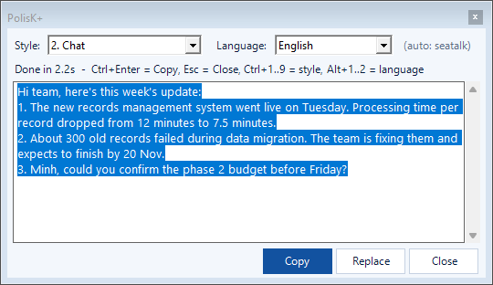
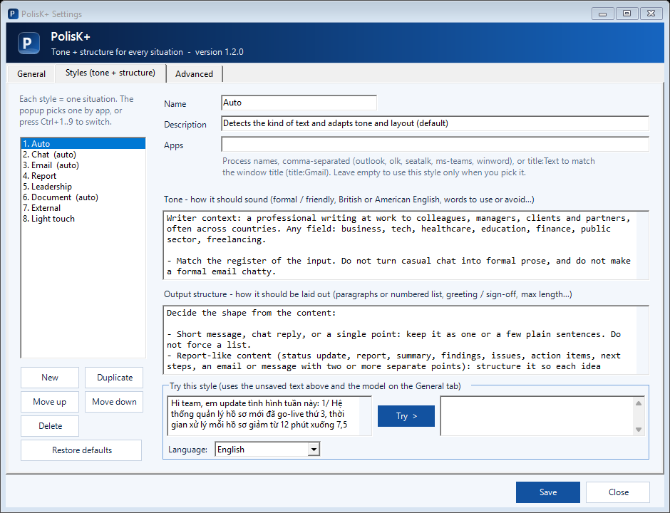

# PolisK+

Select text in any Windows app, press **Ctrl+Alt+P**, and get it back as clear, natural English.

I built this for people who write to colleagues in English every day but whose first draft is half Vietnamese, half English. Before, I copied the draft into a chat window, typed "rewrite this in English", copied the answer back and fixed the parts that sounded like a robot. Now it's one shortcut.

It isn't tied to one industry. If your job involves English messages, emails, reports or documents, it fits: office and project work, sales and support, HR, finance, engineering, healthcare admin, teaching, research, freelancing.

Hướng dẫn tiếng Việt: [README.vi.md](README.vi.md)



## What it does

- **Works where you write.** Outlook, Teams, Slack, SeaTalk, Word, Excel, Chrome: if you can select the text, PolisK+ can polish it.
- **Takes messy input.** Vietnamese, English, or a mix of both in one sentence.
- **Matches the situation.** A SeaTalk message comes back as a short chat reply. An Outlook draft comes back as an email. A weekly update comes back as a numbered list. It picks the style from the app you're in, and you can switch with Ctrl+1..9.
- **Doesn't sound like AI.** The prompt bans the usual giveaways: "delve", "I hope this email finds you well", "seamless", forced groups of three, em dashes. It keeps your numbers, names and dates as written and never adds facts that weren't in your draft.
- **Other languages when you need them.** English is the default. Add the few languages you actually use (Vietnamese, Japanese, Chinese...) and switch in the popup with Alt+1..8.
- **Copy or Replace.** Copy the result, or press Replace to paste it straight over your selection. Your clipboard is put back afterwards.

## Example

You type this in SeaTalk:

```
Hi team, em update tình hình tuần này: 1/ Hệ thống quản lý hồ sơ mới đã go-live thứ 3, thời gian
xử lý mỗi hồ sơ giảm từ 12 phút xuống 7,5 phút. 2/ Còn khoảng 300 hồ sơ cũ bị lỗi khi chuyển dữ liệu,
team đang fix, dự kiến xong 20/11. 3/ Cần anh Minh confirm budget phase 2 trước thứ 6 nhé.
```

You get this back in about 3 seconds:

```
Hi team, here's this week's update:
1. The new records management system went live on Tuesday. Processing time per record dropped from 12 minutes to 7.5 minutes.
2. About 300 old records failed during data migration. The team is fixing them and expects to finish by 20 Nov.
3. Minh, could you confirm the phase 2 budget before Friday?
```

The day, the date and the numbers are kept, "anh Minh" becomes just "Minh", and the loose "1/ 2/ 3/" turns into a clean list.

## What you need

- Windows 10 or 11. **No admin rights needed**: everything goes into your own user folder, with no services and nothing system-wide.
- A paid Claude plan (Pro, Max, Team or Enterprise). PolisK+ runs through the Claude Code command-line tool with your own login. No API key.
- Claude Code CLI. If it's missing, Setup offers to install it for your user.

## Install

1. Download `PolisK+-<version>.zip` from [Releases](../../releases).
2. Extract the whole zip, then double-click **Setup.cmd**.
   If Windows blocks it: right-click the zip > Properties > tick **Unblock** > OK, and extract again.
3. Sign in to Claude when Setup asks.
4. Look for the navy **P** icon in the system tray (it may be under the ^ arrow). That's it.

To upgrade, run Setup from the new zip. Styles and settings you changed are kept.

## Use

1. Select some text.
2. Press **Ctrl+Alt+P**. A small popup opens next to your mouse.
3. Check the result, edit it if you like, then:

| Key | Action |
|---|---|
| Ctrl+Enter | Copy the result and close |
| Replace button | Paste the result over your original selection |
| Ctrl+1..9 | Rewrite in another style |
| Alt+1..8 | Rewrite in another language |
| Esc | Cancel or close |

## Make it yours

Open Settings from the Start Menu or by double-clicking the tray icon.



- **Styles.** Eight are built in: Auto, Chat, Email, Report, Leadership, Document, External and Light touch. Each one is a short description of the tone and the layout, written in plain words. Change a line like `Write in British English.` or `Never use lists.`, press **Try** to see the effect, then Save. You can also make your own style and tell it which apps to use it in.
- **Languages.** Type any language name, and keep the list short so picking one stays quick.
- **Hotkey, model, timeout.** The recommended settings are one click away.

Styles are plain `.md` files in the `profiles` folder, so you can share a good one with a colleague by sending them the file.

## Privacy

- Your text goes to Anthropic through your own Claude Code login, just like pasting it into Claude yourself. PolisK+ doesn't save it anywhere. The log file records errors only, never content.
- Each request runs with no tools, no MCP servers, no project files and no session history. Claude only gets your text and the writing instructions.
- If your company has rules about what you can send to AI services, follow them.

## How it works

There's no installer and no .exe. `polish.ps1` compiles a small C# app in memory when it starts, using the .NET Framework that ships with Windows. The app registers the hotkey, sends Ctrl+C to grab your selection, restores your clipboard, and runs `claude -p` with a system prompt built from three parts: the core rules (`prompt/rules.md`), the chosen style and, if it isn't English, the output language.

## Limits

- Each request takes 3 to 7 seconds, mostly Claude Code starting up.
- Windows only.
- Some locked-down work laptops block PowerShell from compiling code (Constrained Language Mode). Setup checks for this and tells you.
- Every request uses a little of your Claude plan's quota.

## Uninstall

Start Menu > PolisK+ > **Uninstall PolisK+**. Your styles and settings are backed up to `Documents` first.

## License

MIT. See [LICENSE](LICENSE).

PolisK+ is a personal project and isn't affiliated with Anthropic. Claude and Claude Code are products of Anthropic.
